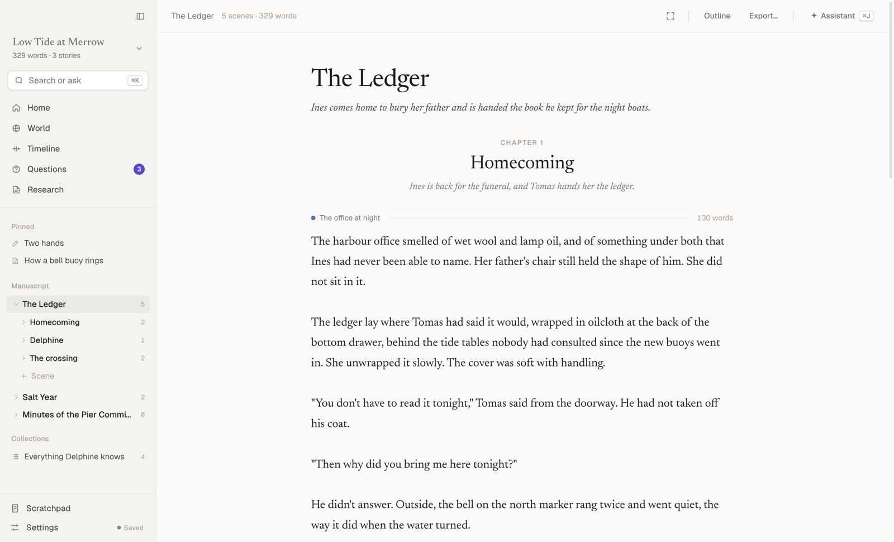
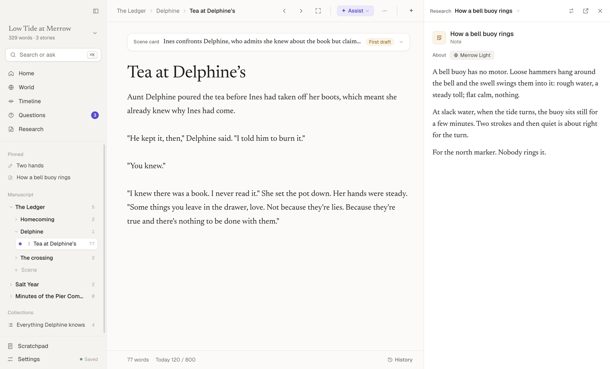
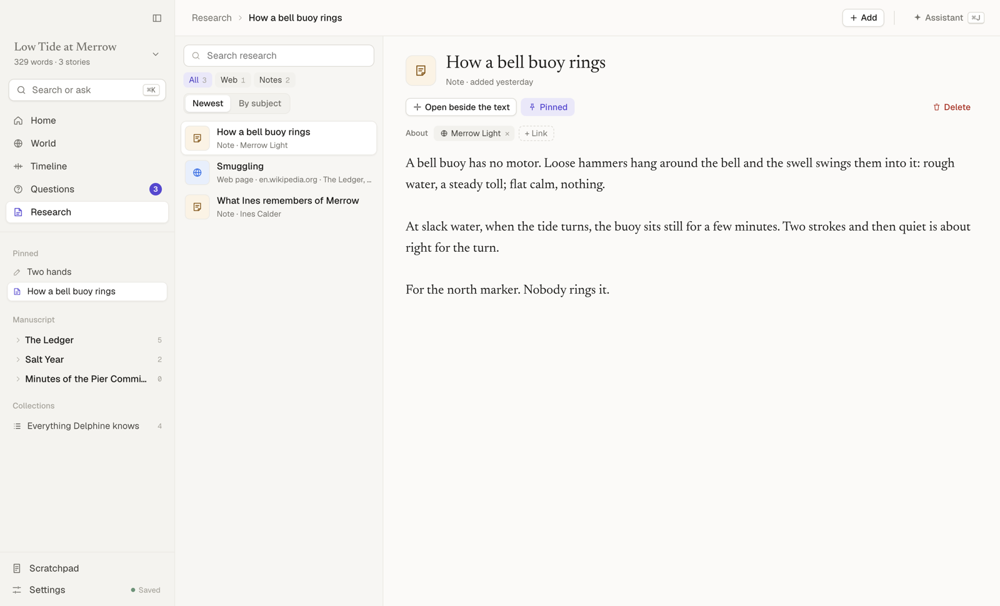
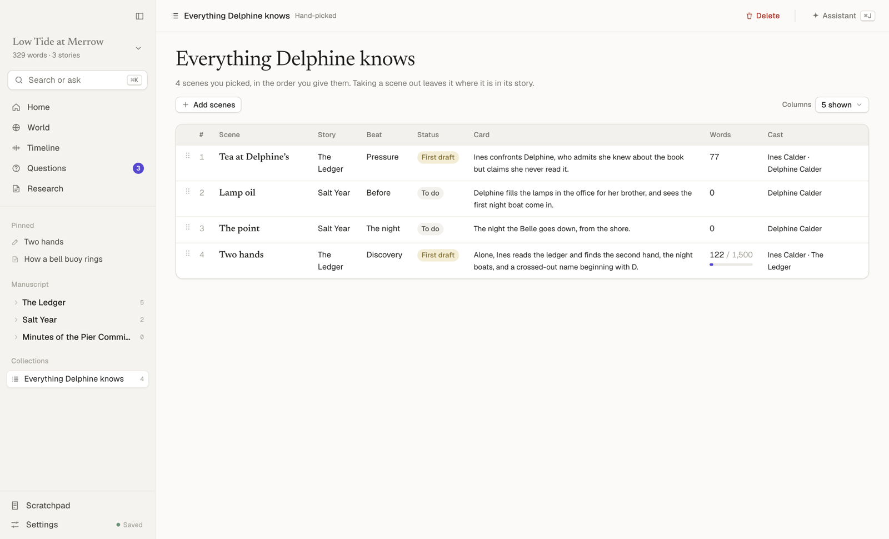
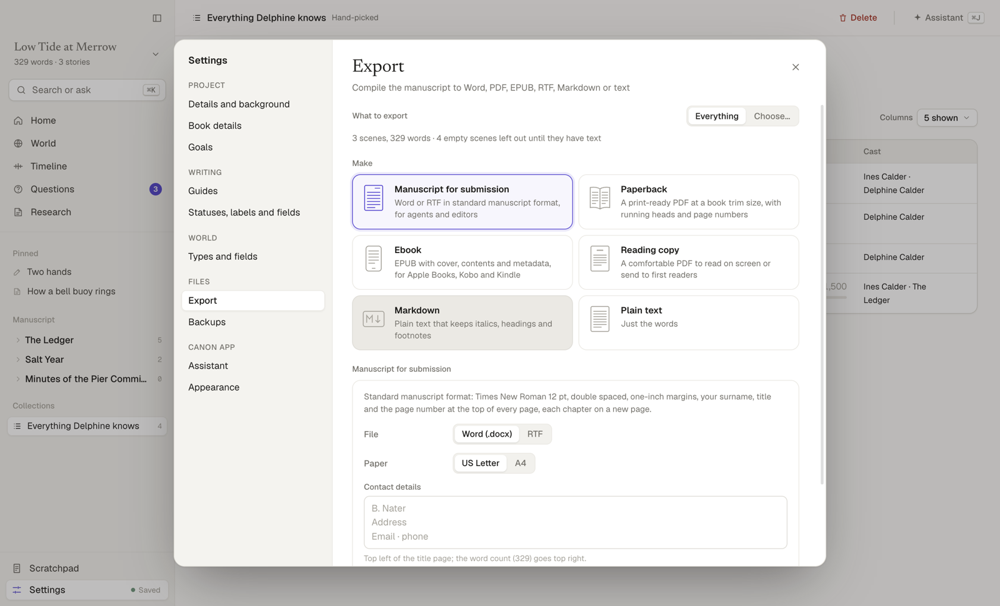
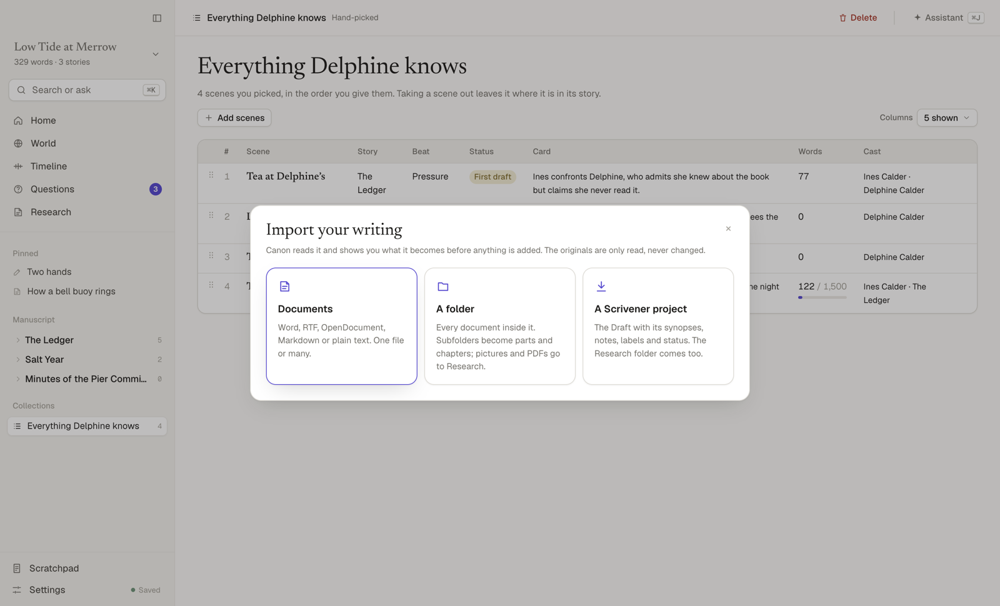
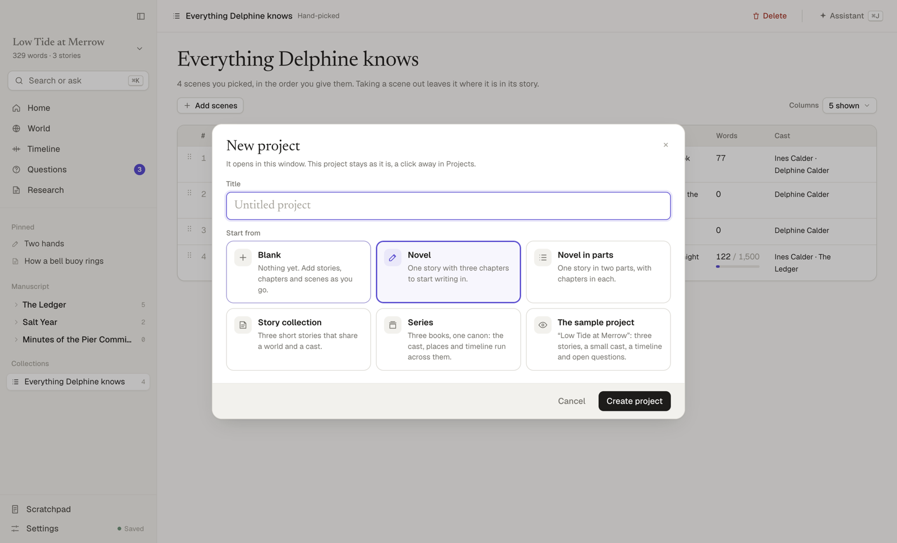

# Canon

A desktop studio for building a story cycle from its parameters: the people and places, the events and who knows them, and the scenes.
The AI renders prose and documents from them; checks run against the canon. Everything stays on your machine.


## A tour

The screenshots show the sample project, “Low Tide at Merrow”, which you can open from the first-run screen or as a template for a new project.

### Writing

A scene, with its card above the prose and the assistant alongside. The chips at the top of the panel show what the assistant can see.
Nothing the assistant does changes your work until you accept it: rewrites arrive as suggestions in the text, feedback as margin notes, canon changes as a list to tick.

Prose is plain text with a little formatting, shown as you type and never hidden: `*italic*`, `**bold**`, `> ` for a block quote, `# ` for a heading,
`^[a footnote]`, and a line of `* * *` for a scene break. ⌘B, ⌘I and the Format menu add them for you. ⌘F finds and replaces inside the scene.


### The manuscript

Each story is a sequence of scenes, which you can gather into chapters and chapters into parts. The sidebar shows the whole tree: drag to reorder,
drop a scene on a chapter to move it there, right-click for everything else. The outline shows a story as a board of cards, one column per chapter
(or grouped by beat, status or label), or as a list. Statuses are yours to name in Settings, as are the label colours and extra scene fields.


### The whole text

Open a story, part or chapter as one continuous page and read or revise across scene boundaries the way a reader meets them.
Each scene keeps its own record, card and history; a quiet line marks where one ends. Focus mode (⇧⌘↵) and typewriter scrolling work here too.



### Side by side

⌥⌘R opens a second pane beside whatever you are writing: another scene, a whole chapter, a character sheet, an event, or a research item.
⌥-click any link, or press ⌥↵ in ⌘K, to open it there.



### Research

PDFs, images, web pages, audio, video and notes, kept in the project and linked to the characters, places and stories they are about.
Drop files on the page or paste a link; a web page is kept as readable text. Each sheet in World lists its research, and anything can be pinned to the sidebar.



### Collections

A smart collection is a saved filter (every scene with Delphine in it, every first draft); a hand-picked one is scenes you choose, in the order you choose.
Find (⇧⌘F) searches scene text, titles, cards, notes, sheets, research and guides, and can save what it finds as a collection.



### World

A sheet for every character, place and object: its fields, relations, what it knows, the scenes it appears in, its research, and voice rules sent with drafts.
The kinds and their fields are yours to change in Settings.


### Timeline

Events in world order, against the scenes in each story that show them. A solid chip means the scene shows the event; a dashed one means it only shows the effect.
Events keep their codes (E1, E2…) when you reorder them; undated facts get F-codes.


The Knowledge lens shows who knows what, and from which story on. Drafts and checks enforce it.


### Questions

Open questions, plot holes and contradictions wait here until you decide them: pick an answer, review what it changes in the canon, then decide.


### Export and print

Pick what the file is for, not a format: a manuscript for submission (Word or RTF in standard manuscript format), a print-ready paperback PDF,
an EPUB with cover and contents, a reading copy, Markdown or plain text. Export everything or tick the parts, chapters and scenes to include.
Front and back matter (dedication, epigraph, copyright, acknowledgements, about the author) live in Book details. ⌘P prints.



### Import and projects

Bring in Word, RTF, OpenDocument, Markdown or text files, a folder of them, or a whole Scrivener project with its synopses, notes, labels, status and research.
You see what everything becomes before anything is added, and the originals are only read.



Each project is its own file with its own research and backups. Start one blank or from a template (a novel, a novel in parts, a story collection, a series),
and switch between them with ⇧⌘O. Backups can be restored from Settings.



### Settings and first run

One window for the project's details, book details, goals, guides, statuses and types, and for the assistant, export, backups and appearance.
Goals can work out the daily target from a deadline and the days you write. The assistant uses one default model, which you can override for each kind of job.


## Run it

```sh
npm install
npm start          # build and open the app
```

Build an installable app with `npm run dist:mac` (on a Mac: a `.dmg` and `.zip` for Apple silicon and Intel, in `release/`),
or `npm run dist` for the current platform. Builds are unsigned, so the first time, right-click the app and choose Open.

## Develop

```sh
npm run dev        # Vite with hot reload for the UI, Electron pointed at it
npm test           # unit tests (store, structure, prose, compile, Word, EPUB, import, projects, research, API…)
npm run typecheck
npm run build && xvfb-run -a npm run smoke     # end-to-end: drives the real app (undo, restart, Word/EPUB/PDF export)
npm run build && xvfb-run -a npm run screens   # screenshots of every view, light and dark, in .screens/
```

To shoot only some views, pass their routes, for example `SCHEMES=light npm run screens -- home settings:goals menu:import`
(`menu:<command>` shoots the dialog a menu command opens; `do:<command>` and `click:<selector>` set the scene for the next shot).
The README's images in `docs/screenshots/` come from that script, scaled to 1600 px wide (`sips -Z 1600`).

(`xvfb-run` is only needed without a display.) `node scripts/seed.ts <dir>` writes a sample project; open it with `CANON_DATA_DIR=<dir> npm start`.

## How it fits together

- `src/main/`: the Electron main process. `main.ts` opens the window, builds the menu and serves the UI over a private
  `canon://app/` protocol, so there is no network port. `api.ts` is the API behind it as a plain `Request → Response`
  function (`db.ts` records and history in SQLite via `node:sqlite`, `ai.ts` streaming model calls, `auth.ts` and `siwc.ts` sign-in),
  with routes for `projects.ts` (the project library, backups and restore), `research.ts` (research files), `convert.ts` (reading Word, RTF,
  OpenDocument, HTML, Markdown, folders and Scrivener projects for import) and `exporter.ts` (`docx.ts` Word and RTF, `epub.ts`, PDF through Chromium).
  Native parts (save and open dialogs, PDF rendering, printing, Finder) come in through a small `Host` interface, so the API runs under plain Node in tests.
- `src/renderer/`: the React UI. It talks to the API with `fetch('/api/…')`; menu commands arrive as DOM events, so there is no preload script.
  `prose.ts` parses the light formatting; `compile.ts` turns the manuscript into the document every export format is written from.

All canon lives in SQLite as typed records (project, entity, fact, question, story, section, scene, research, guide, note, chat, day).
A section is a part or a chapter: it shares its story's scene order and runs until the next section of the same or a higher level, so moving a chapter
moves its scenes with it. A fact with a time is an event; questions hold open questions, plot holes and contradictions until you decide them.
Every change is kept: ⌘Z / ⌘⇧Z undo and redo across the whole canon (inside a text field they undo typing; chats, daily word counts and imports are outside undo).
On every open Canon copies the project into its `backups` folder and keeps the newest 10. Closing the window, or quitting, waits until the last edit is written.

Data lives in `~/Library/Application Support/Canon/` (`%APPDATA%\Canon` on Windows, `~/.config/Canon` on Linux):
the first project as `canon.db` with `files/` (research) and `backups/` beside it, further projects in `Projects/<title>/` with the same three,
`projects.json` (which project is open, and recent ones), `auth.json` (credentials, mode 600) and `settings.json` (the default model and any per-job overrides).
This is the same place the earlier command-line version used, so existing projects open as they are.
Override it with `CANON_DATA_DIR=…` or `--data-dir=…`. `--root=<folder>` preselects a story folder for the one-time import; otherwise Welcome asks for one. The folder is only read.

ChatGPT uses the official Sign in with ChatGPT flow for open-source apps (plan usage only, no conversation or account access; see developers.openai.com/siwc).
OpenRouter can connect through its OAuth flow or take a pasted key; OpenCode Go takes a key. Sign-ins open in your browser and return to Canon when they finish.

## Keys

| | |
|---|---|
| ⌘K | Search everything, run a command, or ask the assistant (⌥↵ opens a result beside) |
| ⌘J | Assistant |
| ⌘\\ | Sidebar |
| ⌥⌘R | Reference pane |
| ⌘N / ⌥⌘N / ⌘⇧N | New scene / new chapter / new story |
| ⌘1 to ⌘6 | Home, Outline, World, Timeline, Questions, Research |
| ⌘[ / ⌘] | Back / forward |
| ⌥⌘↑ / ⌥⌘↓ | Previous / next scene |
| ⌘B / ⌘I | Bold / italic |
| ⌥⌘' / ⌥⌘F / ⌥⌘↵ | Block quote / footnote / scene break |
| ⌘⇧↵ | Focus mode |
| ⌘F | Find and replace in the scene |
| ⌘⇧F | Find and replace across the project |
| ⌘O / ⇧⌘O | Open a project file / switch project |
| ⇧⌘I | Import |
| ⌘E / ⌘P | Export / print |
| ⌘, | Settings |
