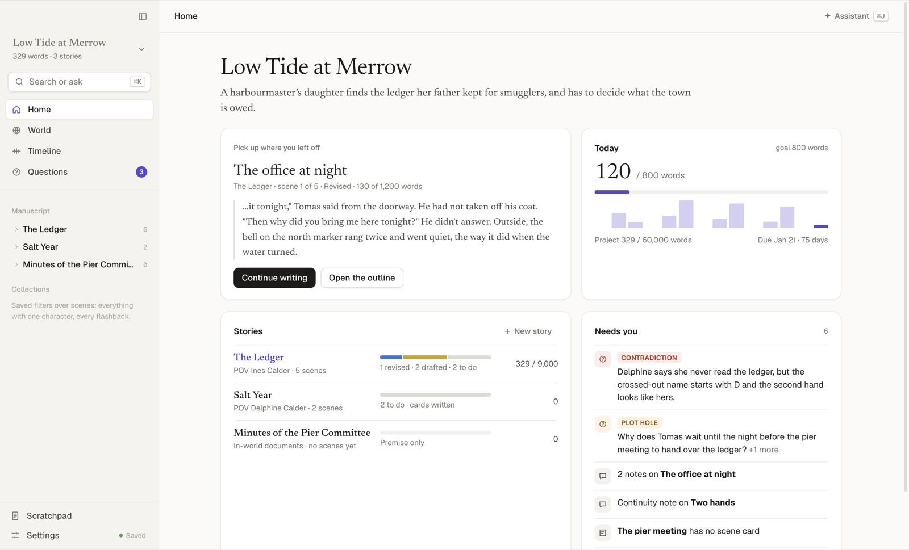
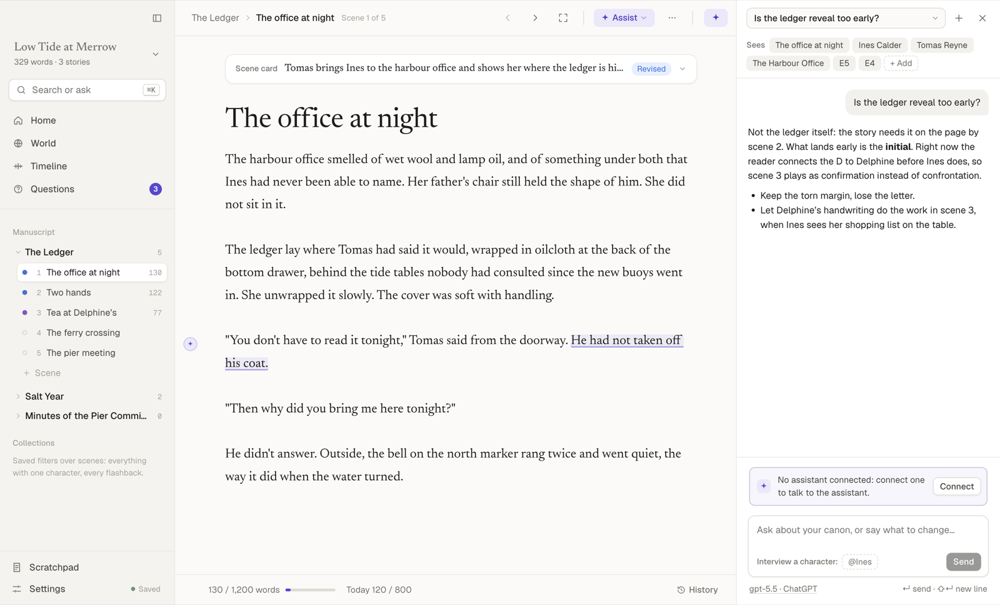
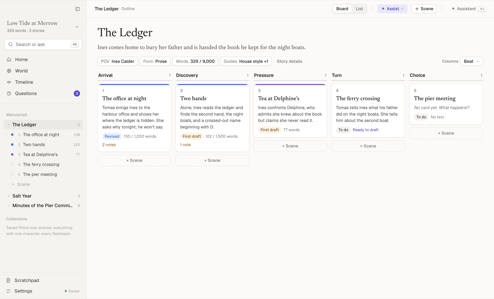
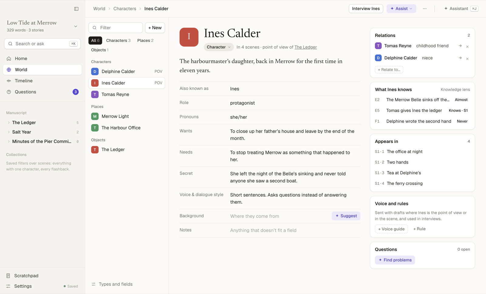
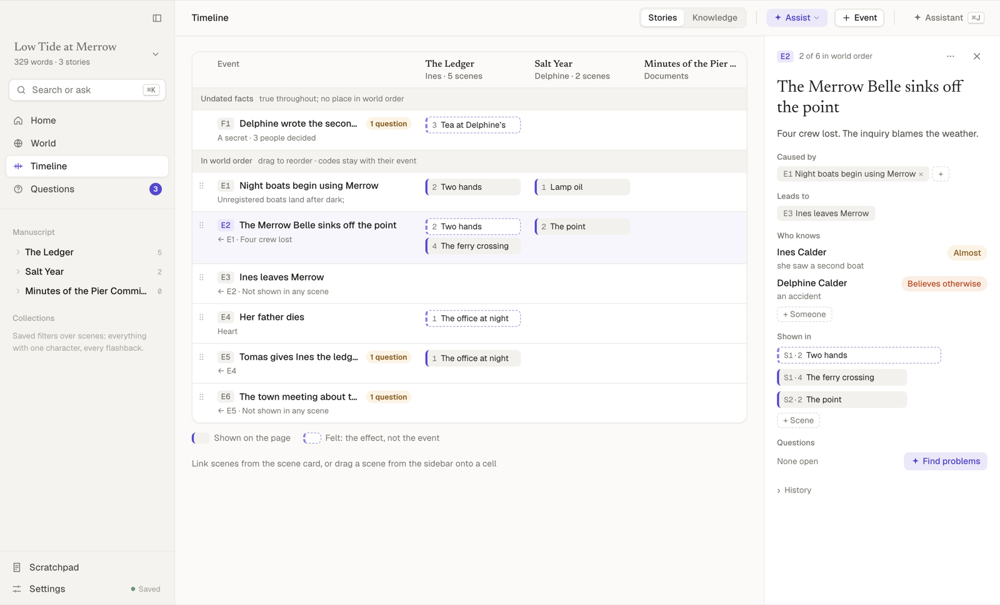
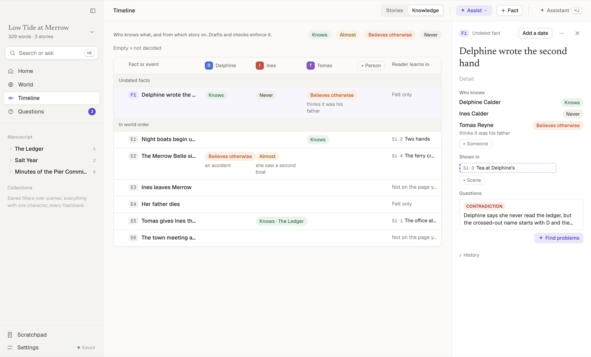
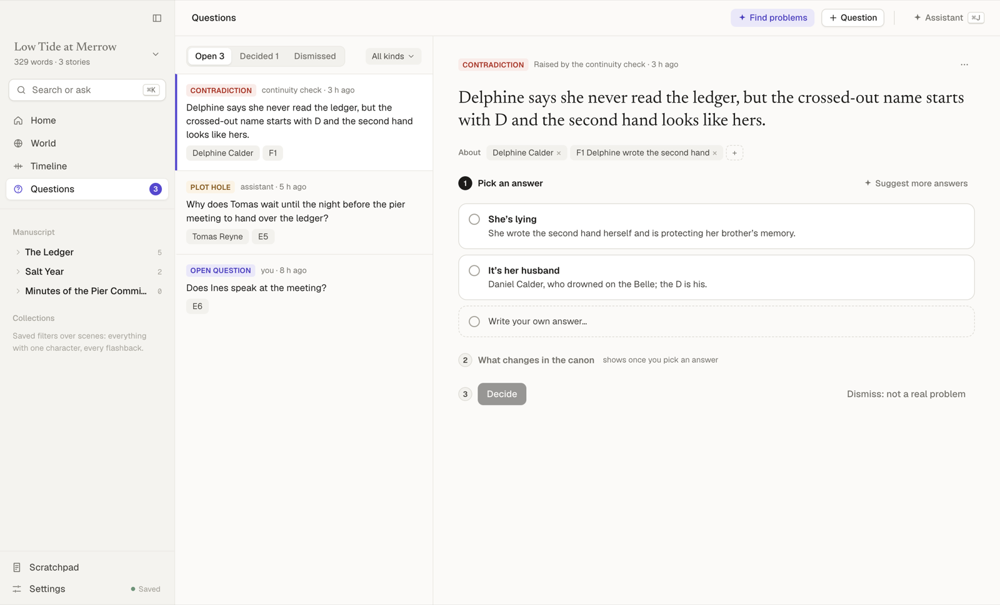
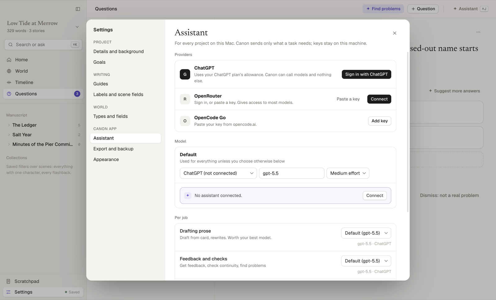
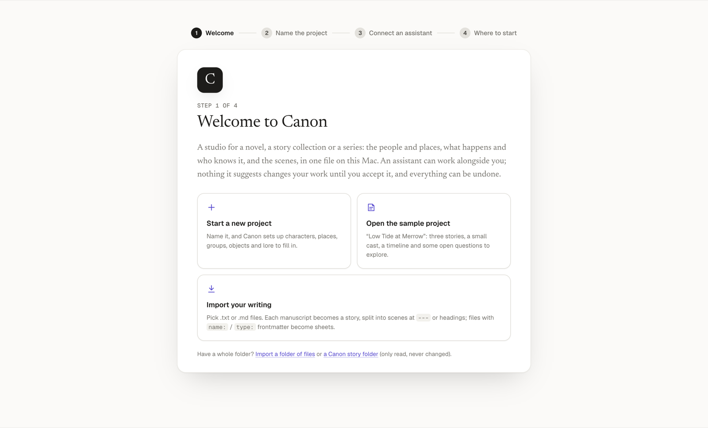

# Canon

A desktop studio for building a story cycle from its parameters: the people and places, the events and who knows them, and the scenes.
The AI renders prose and documents from them; checks run against the canon. Everything stays on your machine.



## A tour

The screenshots show the sample project, “Low Tide at Merrow”, which you can open from the first-run screen.

### Writing

A scene, with its card above the prose and the assistant alongside. The chips at the top of the panel show what the assistant can see.
Nothing the assistant does changes your work until you accept it: rewrites arrive as suggestions in the text, feedback as margin notes, canon changes as a list to tick.



### Outline

Each story as a board of scene cards, grouped by beat, status or label or laid out in story order, or as a list.
Cards show status, words against target, open notes, and which ones are ready to draft from their card.



### World

A sheet for every character, place and object: its fields, relations, what it knows, the scenes it appears in, and voice rules sent with drafts.
The kinds and their fields are yours to change in Settings.



### Timeline

Events in world order, against the scenes in each story that show them. A solid chip means the scene shows the event; a dashed one means it only shows the effect.
Events keep their codes (E1, E2…) when you reorder them; undated facts get F-codes.



The Knowledge lens shows who knows what, and from which story on. Drafts and checks enforce it.



### Questions

Open questions, plot holes and contradictions wait here until you decide them: pick an answer, review what it changes in the canon, then decide.



### Settings and first run

One window for the project's details, goals, guides, labels and types, and for the assistant, export and appearance.
The assistant uses one default model, which you can override for each kind of job.





## Run it

```sh
npm install
npm start          # build and open the app
```

Build an installable app with `npm run dist:mac` (on a Mac: a `.dmg` and `.zip` for Apple silicon and Intel, in `release/`),
or `npm run dist` for the current platform. Builds are unsigned, so the first time, right-click the app and choose Open.

## Develop

```sh
npm run dev        # Vite with hot reload for the UI, Electron pointed at it
npm test           # unit tests (store, undo, API, EPUB, ID tokens, import, diff, find, lint)
npm run typecheck
npm run build && xvfb-run -a npm run smoke     # end-to-end: drives the real app (undo, restart, PDF/EPUB export)
npm run build && xvfb-run -a npm run screens   # screenshots of every view, light and dark, in .screens/
```

To shoot only some views, pass their routes, for example `SCHEMES=light npm run screens -- home settings:goals`.
The README's images in `docs/screenshots/` come from that script, scaled to 1600 px wide (`sips -Z 1600`).

(`xvfb-run` is only needed without a display.) `node scripts/seed.ts <dir>` writes a sample project; open it with `CANON_DATA_DIR=<dir> npm start`.

## How it fits together

- `src/main/`: the Electron main process. `main.ts` opens the window, builds the menu and serves the UI over a private
  `canon://app/` protocol, so there is no network port. `api.ts` is the API behind it as a plain `Request → Response`
  function (`db.ts` records and history in SQLite via `node:sqlite`, `ai.ts` streaming model calls, `auth.ts` and `siwc.ts` sign-in, `epub.ts`).
  Native parts (save dialogs, PDF rendering, Finder) come in through a small `Host` interface, so the API runs under plain Node in tests.
- `src/renderer/`: the React UI. It talks to the API with `fetch('/api/…')`; menu commands arrive as DOM events, so there is no preload script.

All canon lives in SQLite as typed records (project, entity, fact, question, story, scene, guide, note, chat, day).
A fact with a time is an event; questions hold open questions, plot holes and contradictions until you decide them.
Every change is kept: ⌘Z / ⌘⇧Z undo and redo across the whole canon (inside a text field they undo typing; chats, daily word counts and the import are outside undo).
On every start Canon copies the database into a `backups` folder next to it and keeps the newest 10. Closing the window waits until the last edit is written.

Data lives in `~/Library/Application Support/Canon/` (`%APPDATA%\Canon` on Windows, `~/.config/Canon` on Linux): `canon.db`, `backups/`,
`auth.json` (credentials, mode 600), `settings.json` (the default model and any per-job overrides). This is the same place the earlier command-line version used, so existing projects open as they are.
Override it with `CANON_DATA_DIR=…` or `--data-dir=…`. `--root=<folder>` preselects a story folder for the one-time import; otherwise Welcome asks for one. The folder is only read.

ChatGPT uses the official Sign in with ChatGPT flow for open-source apps (plan usage only, no conversation or account access; see developers.openai.com/siwc).
OpenRouter can connect through its OAuth flow or take a pasted key; OpenCode Go takes a key. Sign-ins open in your browser and return to Canon when they finish.

## Keys

| | |
|---|---|
| ⌘K | Search everything, run a command, or ask the assistant |
| ⌘J | Assistant |
| ⌘\\ | Sidebar |
| ⌘N / ⌘⇧N | New scene / new story |
| ⌘1 to ⌘5 | Home, Outline, World, Timeline, Questions |
| ⌘[ / ⌘] | Back / forward |
| ⌥⌘↑ / ⌥⌘↓ | Previous / next scene |
| ⌘⇧↵ | Focus mode |
| ⌘⇧F | Find and replace across the project |
| ⌘, | Settings |
| ⌘E | Export (EPUB, PDF, Markdown, plain text) |
